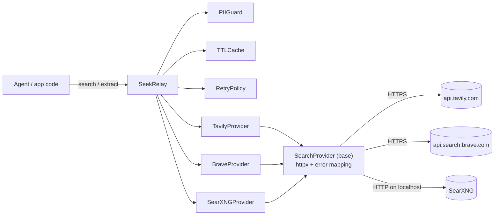
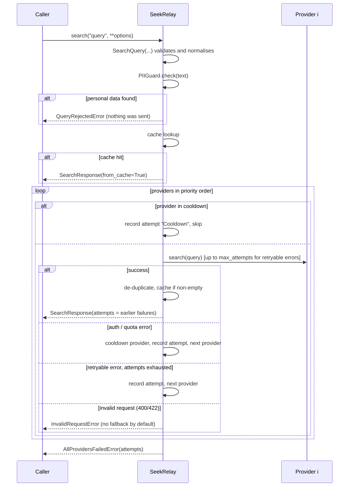

# Architecture

## Goals

1. **Provider independence.** Application and agent code depend on one small model
   (`SearchQuery` -> `SearchResponse`), not on vendor SDKs or payloads.
2. **Graceful degradation.** A provider that is out of credits, rate-limited or down
   costs a fallback, not an outage.
3. **Safe by default for LLM use.** Web text is treated as untrusted data; obvious
   personal data never leaves the process.
4. **Small and auditable.** One runtime dependency (`httpx`), no global state, strict
   typing, every network path testable with a mock transport.

Non-goals for now: crawling whole sites, a shared/distributed cache, ranking fusion
across providers (results come from the first provider that succeeds).

## Components

| Module | Responsibility |
|---|---|
| `models.py` | Immutable, validated `SearchQuery` (also the cache key); result and response types; URL helpers; prompt-safe rendering |
| `errors.py` | Exception hierarchy; `retryable` and `fallback` flags drive the relay |
| `providers/base.py` | Owns the `httpx.AsyncClient`, sends requests, maps transport errors and HTTP status codes to exceptions |
| `providers/*.py` | Translate `SearchQuery` to one API and the answer back; provider-specific status codes |
| `relay.py` | Ordering, retries, fallback, cooldown, cache, de-duplication, sync wrapper |
| `pii.py` | Detects e-mails, Luhn-valid card numbers, mod-97-valid IBANs (phones optional) |
| `cache.py` | In-memory TTL + LRU cache |
| `config.py` | Build providers/relay from environment variables; minimal `.env` reader |
| `cli.py` | `seekrelay` command |

## Request flow

`extract()` follows the same loop, restricted to providers with
`supports_extract = True`.

## Error model

Every provider failure is a `ProviderError` subclass. Two class attributes decide what
the relay does with it:

| Exception | Typical cause | `retryable` | `fallback` | Cooldown |
|---|---|:-:|:-:|:-:|
| `ProviderUnavailableError` | timeout, connection or other HTTP-client error, HTTP 408/5xx, Tavily 434, SearXNG with no results while upstream engines time out or fail | yes | yes | no |
| `RateLimitError` | HTTP 429 (`retry_after` parsed from `Retry-After` / `X-RateLimit-Reset`); SearXNG with no results while its upstream engines are suspended or behind a CAPTCHA (`retry_after` 180 s) | yes | yes | for `retry_after` seconds, if longer than `max_delay` |
| `QuotaExceededError` | Tavily 432/433, HTTP 402, Brave 429 with an exhausted plan (`QUOTA_LIMITED`) | no | yes | yes |
| `AuthenticationError` | HTTP 401/403, SearXNG JSON disabled | no | yes | yes |
| `ResponseFormatError` | 2xx with an unexpected payload, undecodable body | no | yes | no |
| `ProviderError` (base) | other HTTP errors, unexpected redirect, any unexpected exception inside a provider (logged with traceback) | no | yes | no |
| `InvalidRequestError` | HTTP 400/413/414/422 | no | **no** | no |
| `UnsupportedOperationError` | `extract` on a provider without it, or a request the provider cannot express (query too long for Brave once `-site:` operators are added) | no | yes | no |

Malformed items inside a successful response (a result without a valid http(s) URL, a
number where a string is expected) do not fail the call: invalid URLs are skipped and
fields are coerced to strings.

Errors outside the provider hierarchy:

| Exception | Raised when |
|---|---|
| `QueryRejectedError` | PII guard blocked the query or URL; carries `findings` (kinds only, never values) |
| `ConfigurationError` | no providers, empty key, invalid base URL, unknown provider name |
| `AllProvidersFailedError` | every provider failed or was skipped; carries `attempts` |
| `ValueError` / `TypeError` | invalid `SearchQuery` arguments |

### Why invalid requests do not fall back

A 400 usually means the request itself is wrong, so the next provider would fail the
same way. More importantly, a provider may reject a query *on purpose*: Tavily blocks
queries in which it detects personal data. Falling back would send exactly that query to
another third party. `fallback_on_invalid_request=True` exists for setups where this
trade-off is acceptable.

### Retries versus fallback

* Retries are per provider and only for `retryable` errors, with exponential back-off
  (`base_delay * 2^(n-1)`, capped by `max_delay`, +/- jitter).
* A `Retry-After` shorter than `max_delay` is honoured exactly. A longer one is not
  waited for; the relay falls back immediately, because an agent waiting a minute is
  worse than an answer from the next provider, and skips that provider for `retry_after`
  seconds (unless `cooldown_seconds=0`), because asking earlier only costs a round trip.
* Auth and quota errors are never retried and put the provider into cooldown
  (`cooldown_seconds`, default 300 s), so a month of exhausted credits does not cost a
  failed round trip on every request.
* Without a limit, one call can take up to providers x attempts x timeout (about two
  minutes with the defaults). `time_budget` caps the whole call: the request running
  when it expires is cancelled and recorded as `ProviderUnavailableError`, providers not
  tried yet are recorded as `TimeBudget`, and the call raises `AllProvidersFailedError`.

## Design decisions

| Decision | Reason |
|---|---|
| Async core, thin sync wrapper | Agents and web services are async; the wrapper keeps one private loop so the connection pool stays valid between calls |
| `SearchQuery` is frozen and hashable | It doubles as the cache key; validation happens once, at construction |
| Normalised fields only (`title`, `url`, `snippet`, `score`, `published_at`, `raw_content`, `source_engines`) | Enough for ranking and prompting; provider-specific extras stay out of the contract |
| First successful provider wins, no result fusion | Predictable cost: one paid call per search. Fusion is a possible later feature |
| Domain filters enforced client-side for Brave/SearXNG | Their operators are best effort; the client-side filter guarantees correctness. The provider over-fetches 20 results so enough survive |
| SearXNG "0 results + unresponsive engines" is an error | Returning an empty list would stop the fallback chain although the real cause is upstream CAPTCHAs/timeouts |
| Only non-empty responses are cached | An empty answer is often transient |
| The cache stores and returns copies | Callers may mutate the response they get; cache hits report `attempts=()` instead of replaying an old fallback history |
| `follow_redirects=False` | A redirect from an API usually means a wrong base URL or a login page; it is reported, not followed |
| `PIIGuard` favours precision | Card numbers need a valid Luhn checksum and a 2-6 prefix, IBANs a valid mod-97 checksum; phones are opt-in |
| No logging of secrets or PII | `repr()` of providers omits keys; `QueryRejectedError` lists kinds of data only |
| Library logger has a `NullHandler` | The application decides where logs go (`logging.getLogger("seekrelay")`) |

## Concurrency

`SeekRelay.search` is safe to call concurrently from one event loop
(`asyncio.gather`). Each provider shares one `httpx.AsyncClient` connection pool. The
cache and cooldown state are plain dictionaries mutated without awaits in between, so
no locking is needed within one loop. Do not share one relay between threads or
event loops; create one per loop.

## Extension points

* New provider: subclass `SearchProvider` - see [EXTENDING.md](EXTENDING.md).
* Custom HTTP setup (proxy, mTLS, shared pool): pass `client=httpx.AsyncClient(...)`
  to a provider; injected clients are not closed by the provider.
* Custom PII rules: pass a configured `PIIGuard`, or `pii_guard=None` and check
  upstream.
* Shared cache: the relay only needs `get(key)` / `set(key, value)`; a Redis-backed
  variant can replace `TTLCache` in a later version.
